<h1 align="center">Henry Hsu</h1>

<p align="center">
  M.C.S. @ Rice (Dec 2026) · Ex-SWE Intern @ Google · Ex-GenAI Team Lead @ MaiAgent
</p>

<p align="center">
  <a href="https://www.yarikama.com/"></a>
  <a href="https://www.linkedin.com/in/yarikama/"></a>
  <a href="mailto:hsuhengjui@gmail.com"></a>
</p>

---

### About

I'm a builder who is happy about my work.

---

### Featured Work

<table>
  <tr>
    <td width="50%" valign="top">
      <h4><a href="https://www.yarikama.com/">☸️ yarikama.com</a></h4>
      <sub><em>k3s · Argo CD · vLLM · FastAPI · React</em></sub>
      <p>My personal site, deployed with Argo CD on a k3s cluster at home and running two self-hosted LLMs for chat and editor autocomplete. <a href="https://github.com/yarikama/portfolio-back-end">Code</a></p>
    </td>
    <td width="50%" valign="top">
      <h4><a href="https://github.com/yarikama/PAPIT">🔍 Prompt-Aware Image Token Pruning</a></h4>
      <sub><em>PyTorch · LLaVA · CLIP · Knowledge Distillation</em></sub>
      <p>A tiny scorer distilled from LLaVA's own attention that drops the image tokens the model would ignore anyway, so inference gets cheaper.</p>
    </td>
  </tr>
  <tr>
    <td width="50%" valign="top">
      <h4><a href="https://github.com/yarikama/GGJSSP">📐 Cross-Size GNN Job Shop Scheduling</a></h4>
      <sub><em>PyTorch · Graph Neural Networks · GRPO</em></sub>
      <p>A study of why GNN job shop schedulers trained on small instances break on bigger ones, with two aggregation changes that let them scale.</p>
    </td>
    <td width="50%" valign="top">
      <h4><a href="https://github.com/yarikama/Agentic-Advanced-RAG">🧠 Agentic Hybrid RAG</a></h4>
      <sub><em>LangGraph · CrewAI · Neo4j · Milvus</em></sub>
      <p>A LangGraph agent that picks, per question, between no retrieval, graph search over Neo4j, and entity lookup, all backed by Milvus hybrid search.</p>
    </td>
  </tr>
  <tr>
    <td width="50%" valign="top">
      <h4><a href="https://github.com/run-llama/llama_index/pulls?q=is%3Apr+author%3Ayarikama+is%3Amerged">🦙 LlamaIndex Contributions</a></h4>
      <sub><em>Open Source · 15K+ ⭐</em></sub>
      <p>14 merged PRs with bug fixes and new integrations, including Bedrock, Claude, and the MCP client.</p>
    </td>
    <td width="50%" valign="top">
      <h4>🚀 MaiAgent Production Platform</h4>
      <sub><em>Django · FastAPI · LlamaIndex · AWS</em></sub>
      <p>Led the GenAI team at a startup and turned its chatbots into agents with memory, tools, and MCP.</p>
    </td>
  </tr>
</table>

---

### Tech I Reach For

```text
Languages    Python · TypeScript · C/C++ · Java
Backend      Django · FastAPI · Express · Celery · Nginx
GenAI        LlamaIndex · LangChain · LangGraph · MCP · vLLM
Data         PostgreSQL · Neo4j · Milvus · Elasticsearch · MongoDB · Redis · Chroma
ML / DL      PyTorch · JAX · scikit-learn · NumPy · Pandas
Cloud        AWS (Bedrock · SageMaker · EMR · EC2 · S3 · RDS · ElastiCache)
DevOps       Docker · Kubernetes (k3s) · Argo CD · GitHub Actions · Prometheus · Grafana · Linux
Testing      pytest · JUnit · Vitest
```

<p align="center">
  
</p>

---

### GitHub

<div align="center">
  
  
</div>
